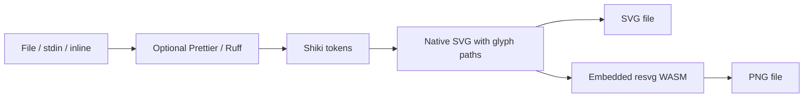

# snipix

A browser-free Bun CLI for Ray.so-style code images. Built for agents and
scripts. Exports portable SVG and PNG files.

All 33 Ray.so theme palettes are included. Rendering uses native SVG glyph
outlines and `resvg` WASM—not HTML, Chromium, or a local server. The compiled
executable embeds its WASM, fonts, grammars, and background images. No Bun,
Node, browser, installed fonts, extraction step, or downloads are needed to run it.


## Install

Download the executable for your OS/CPU from
[GitHub Releases](https://github.com/maharshi365/snipix/releases).
Supported platforms: Windows/macOS/Linux, x64/arm64, with glibc and musl Linux
builds. No runtime installation is required.

On Windows:

```powershell
.\snipix-win32-x64.exe app.ts -o app.png --theme breeze --line-numbers
```

On Linux/macOS, make the downloaded file executable before running it:

```sh
chmod +x ./snipix-linux-x64
./snipix-linux-x64 --help
```

Choose the filename for your OS/CPU. Releases include `SHA256SUMS` to verify downloads.

## Build a single executable

Install [Bun](https://bun.sh), then run:

```sh
bun install
bun run build
```

Output: `dist/snipix.exe` on Windows, or `dist/snipix` on Linux/macOS.
Copy that **one file** to another folder or machine with a compatible OS and
CPU. The Windows x64 build is approximately 118 MiB, including the Bun runtime.

```powershell
.\dist\snipix.exe render app.ts -o app.png --theme breeze --line-numbers --json
.\dist\snipix.exe render --help
```

Cross-compilation uses Bun's executable targets:

```sh
bun run build --target bun-linux-x64 --outfile dist/snipix-linux-x64
bun run build --target bun-darwin-arm64 --outfile dist/snipix-macos-arm64
bun run build --target bun-windows-x64 --outfile dist/snipix.exe
```

Use `bun run build --help` for all accepted targets. Cross-compiled files must
be tested on their target OS. Windows x64 is tested here. Standard OS runtime
requirements for Bun still apply.

To run from source instead, use `bun run start` or run `bun link` to expose
the `snipix` command through Bun. Source mode only needs `bun install`; no renderer
build or browser setup is required.

## Examples

```sh
# File input. Language is inferred from the extension.
snipix render app.ts -o code.png --theme breeze --line-numbers

# Inline code, formatting, light window, native SVG export.
snipix render --code 'const sum=(a,b)=>a+b' -l javascript --format --no-dark-mode -o code.svg

# Piped input and machine-readable result.
cat app.py | snipix render - -l python --format -o app.png --json

# Transparent canvas, title, width, highlighted lines.
snipix render app.ts --no-background --title app.ts --width 800 --highlight 2,4-6 -o app.png

# Raw export bytes on stdout. Specify --type when output is '-'.
snipix render app.ts --type svg -o - > app.svg
```

PowerShell stdin example:

```powershell
Get-Content -Raw app.py | .\dist\snipix.exe render - -l python -o app.png --json
```

`render` is the default command, so `snipix app.ts -o app.png` also works.
In source mode, replace `snipix` with `bun run start`.

## Help and discovery

```sh
snipix --help
snipix render --help
snipix themes --json
snipix languages --json
snipix fonts --json
snipix options --json
snipix licenses
```

| Control | Flags | Default |
| --- | --- | --- |
| Theme | `--theme <id>` | `candy` |
| Background | `--background`, `--no-background` | on |
| Window mode | `--dark-mode`, `--no-dark-mode` | dark |
| Line numbers | `--line-numbers`, `--no-line-numbers` | theme default |
| Padding | `--padding 16\|32\|64\|128` | 64 |
| Language | `--language <id>` | auto |
| PNG scale | `--size 2x\|4x\|6x` | 4x |
| Canvas width | `--width <pixels>` | 680 |
| Font | `--font <id>`, `--font-size <pixels>` | theme font, 15px |
| Window title | `--title <text>` | empty |
| Subtitle | `--subtitle <text>` | empty; Auth0 only |
| Highlight lines | `--highlight 1,3-5` | none |
| Format code | `--format`, `--print-width`, `--tab-width` | off, 80, 2 |
| Export | `--output <path>`, `--type png\|svg` | `snipix.png` |

Language auto-detection uses the extension first, then Highlight.js. Use an
explicit language for repeatable agent output. Shiki provides token colors,
including Ray.so's custom Cedar grammar and Tailwind syntax themes.

Formatting supports JavaScript/JSX, TypeScript/TSX, JSON/JSONC, Markdown/MDX,
HTML, Vue, CSS/SCSS/Less, YAML, GraphQL, and Python. Python uses embedded Ruff
WASM; other languages use bundled Prettier plugins. `--tab-width` applies only
to Prettier. Unsupported formatting requests fail instead of silently skipping
formatting. Source files are never changed.

## Agent contract

Use `--json` with a file output. Success writes one JSON object to stdout:

```json
{"output":"/absolute/path/app.png","type":"png","width":2720,"height":912,"bytes":233032,"language":"typescript","theme":"candy"}
```

Exit code is `0` on success and nonzero on failure. Runtime errors with
`--json` are JSON objects on stderr. Argument syntax errors use standard CLI
error text. Without `--json`, status text goes to stderr. `-o -` writes only
image bytes to stdout and cannot be combined with `--json`.

Missing output directories are created. An existing output file is replaced.
Input is limited to 128 KiB. Exports above 100 million pixels or 30,000 pixels
in height at the selected scale are rejected. SVG uses logical dimensions;
`--size` scales PNG only.

## Differences from Ray.so

- Theme palettes, syntax mapping, Cedar grammar, Tailwind themes, and selected
  background images come from Ray.so's MIT-licensed source.
- Frames are native SVG recreations. Complex partner frames, grids, patterns,
  shadows, and gradients are **approximations**, not pixel-identical copies
  of the React/CSS UI. The vendored React/CSS files remain as design references
  and are not loaded or bundled by the CLI.
- SVG contains reusable glyph paths, not `<foreignObject>` or live text. It
  renders without fonts or a browser. The source is included in `<desc>` for
  accessibility; visible text is not selectable as normal SVG text.
- Nine open-source code fonts are bundled. Söhne Mono is proprietary, so
  OpenAI uses Commit Mono instead.
- Bundled fallback glyphs cover common Latin, Greek, and Cyrillic characters.
  Emoji, CJK, and complex-script shaping are not supported. Missing glyphs
  produce a clear error rather than an empty box or silently missing text.
- Long code lines wrap at glyph boundaries. Wrapped rows retain the logical
  line's highlight; its line number appears only on the first row. Tabs use
  two-space stops. Impossible width/padding/font combinations fail clearly.
- Some partner frames have no title bar. Stripe is dark-only. Line number
  flags can override all theme defaults.

## Layout

```text
src/cli/       commands, input, agent output
src/config/    defaults, choices, validation
src/code/      language selection, formatting, tokenization
src/themes/    upstream palettes and native frame style constants
src/assets/    embedded font and background file imports
src/render/    glyph outlines, wrapping, native SVG, colors, backgrounds
src/export/    SVG bytes and resvg WASM PNG rendering
vendor/ray-so/ upstream references, grammars, assets, license and source commit
scripts/       executable build, isolated smoke test, upstream import
tests/         validation, layout, CLI and real PNG/SVG tests
```



Update upstream data only from a trusted checkout:

```sh
bun scripts/vendor.ts /path/to/ray-so
```

The import script evaluates the upstream theme object. The pinned source
commit is in `vendor/ray-so/UPSTREAM.md`. Native frame constants are maintained
separately and need review when upstream frame designs change.

## Checks

```sh
bun run typecheck
bun test
bun run build
bun run test:executable
```

`test:executable` copies only the executable into a new empty temporary folder
and runs it with an empty `PATH`. It checks TypeScript/Python formatting,
Cedar/Tailwind, PNG/WASM, embedded image assets, SVG, stdin, and help. It also
checks that no runtime assets were extracted beside the executable.

## Releases

Commit your work and sign in to GitHub CLI with `gh auth login`. Then run:

```sh
bun run release:patch
# or: bun run release:minor
# or: bun run release:major
```

The script checks a clean Git tree and GitHub login, runs checks, bumps the
version, builds the local executable, and runs the standalone smoke test. It
then commits the version, creates an annotated `vX.Y.Z` tag, and pushes to
GitHub. The release workflow builds eight executables and publishes them with
`SHA256SUMS` to GitHub Releases.

`dist/`, binaries, archives, credentials, and local caches are excluded from
Git. No credentials are stored in the repo.

## Attribution

Ray.so is by Raycast. Copied source is MIT-licensed, with credit in the root `LICENSE`.
This is not an official Raycast product. Fontsource fonts retain their
respective package licenses. `resvg` WASM is MPL-2.0; its source is available
at https://github.com/yisibl/resvg-js. Other dependencies retain their own
licenses.
`snipix licenses` prints the notices bundled into the executable.
The native `resvg` sources are unmodified and available at
the URL stated in those notices.
Generated license bundles and vendor license copies are not committed. Builds
collect dependency licenses and fetch/cache the resvg license when needed.
